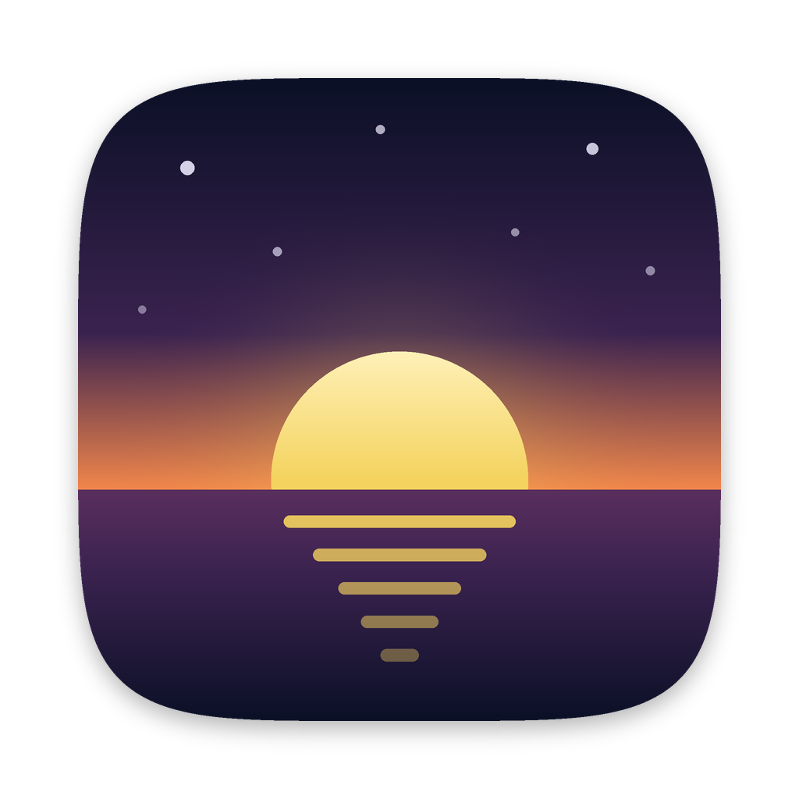

# Hello — a native macOS app

A small SwiftUI application that opens a window with a time-of-day greeting and
today's date. It is the macOS counterpart of the iPhone web app "Hello", and has
the same behaviour and colours:

| Local time    | Greeting                | Background | Text      | Accent    |
|---------------|-------------------------|------------|-----------|-----------|
| 05:00–10:59   | Good morning, Károly    | `#FFE8D6`  | `#3A2E39` | `#A6480B` |
| 11:00–16:59   | Good afternoon, Károly  | `#EAF4FB`  | `#16324F` | `#B8790A` |
| 17:00–20:59   | Good evening, Károly    | `#3B2350`  | `#F3E6D8` | `#F2874B` |
| 21:00–04:59   | Good night, Károly      | `#0B1026`  | `#E4E0F5` | `#F4D35E` |

The date is shown in Hungarian long form, for example *2026. október 30., péntek*.
The window refreshes every minute, so the greeting and the date change while it
stays open. Closing the window quits the app.



## Bundle layout

`build.sh` produces a standard macOS application bundle:

```
build/Hello.app/
└── Contents/
    ├── Info.plist             bundle metadata (identifier, version, minimum macOS)
    ├── PkgInfo                "APPL????"
    ├── MacOS/
    │   └── Hello              universal executable (arm64 + x86_64)
    ├── Resources/
    │   └── AppIcon.icns       app icon, 16–1024 px
    └── _CodeSignature/
        └── CodeResources      ad-hoc code signature
```

## Building on a Mac

Requirements: macOS 13 Ventura or later, and either Xcode or the Command Line
Tools (`xcode-select --install`). No Xcode project is needed.

```sh
git clone https://github.com/karoly-kubicsko/Swift.git
cd Swift
./build.sh --open          # builds build/Hello.app and launches it
```

To install, drag `build/Hello.app` into `/Applications`.

## Ready-made download

Every push is built on a GitHub-hosted macOS runner
(`.github/workflows/build-macos-app.yml`). Open the latest run under the
repository's **Actions** tab and download the **Hello-macOS** artifact. It
contains `Hello.zip`; unzip it to get `Hello.app`.

The app is ad-hoc signed, not notarised, so Gatekeeper blocks a downloaded copy
the first time it is opened. Either:

- try to open it, then choose **System Settings → Privacy & Security → Open Anyway**, or
- remove the quarantine flag: `xattr -dr com.apple.quarantine Hello.app`.

A copy you build yourself with `build.sh` is not quarantined and opens directly.

## Project files

| Path                     | Purpose                                                   |
|--------------------------|-----------------------------------------------------------|
| `Sources/HelloApp.swift` | the whole app: window, greeting view, themes              |
| `Resources/Info.plist`   | bundle metadata, copied into `Contents/`                  |
| `Resources/AppIcon.icns` | generated icon, copied into `Contents/Resources/`         |
| `Icon/make_icon.py`      | regenerates the icon (`python3 Icon/make_icon.py`; needs Pillow and NumPy) |
| `build.sh`               | compiles, assembles and signs the bundle                  |

To greet someone else, change the `name` constant at the top of
`Sources/HelloApp.swift` and rebuild.
